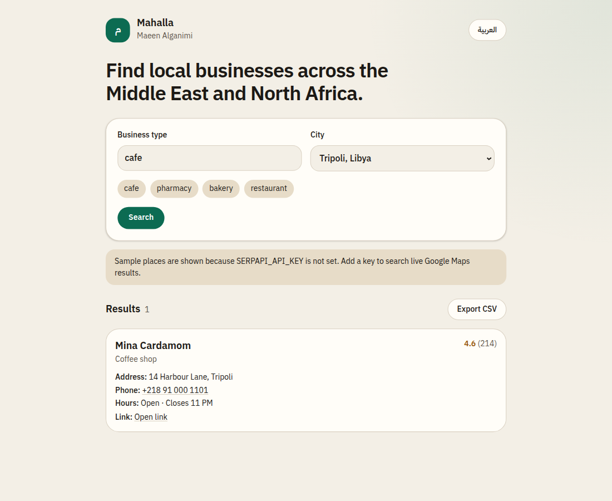

# Mahalla

Mahalla is a bilingual Arabic and English finder for local businesses in Middle East and North Africa cities. Search by business type and city, read the listing, and export the rows as CSV.

Cities: Tripoli, Benghazi, Cairo, Tunis, Amman, Dubai, and Riyadh.



## What it does

- Switches between English and Arabic. Arabic uses a right-to-left layout.
- Searches a business type in one of the preset cities.
- Lists name, rating, review count, type, address, phone, hours, and a link.
- Exports the current results to CSV, with headers in the active language.
- Calls SerpApi’s Google Maps engine when `SERPAPI_API_KEY` is set.
- Without a key, serves fictional sample businesses from `fixtures/demo-places.json`.

## Architecture

The page is a Next.js App Router client. It calls `GET /api/search?q=&city=&hl=`.

The route checks the city and query, then:

1. Reads `SERPAPI_API_KEY` at request time.
2. With a key, requests `https://serpapi.com/search.json` using `engine=google_maps`, `type=search`, `q`, `ll` (the city coordinate), and `hl` (`en` or `ar`).
3. Without a key, builds a SerpApi-shaped payload from the demo fixtures.
4. Runs both paths through `normalizeLocalResults`, which returns a typed listing: name, rating, reviews, address, phone, hours, link, and type.

CSV export happens in the browser from those listings.

A separate n8n workflow in [`n8n/`](n8n/README.md) performs the same Google Maps search with the official SerpApi node and appends rows to Google Sheets.

## Demo mode and live mode

Copy `.env.example` to `.env.local`.

- Leave `SERPAPI_API_KEY` empty for demo mode. Results are original fictional businesses, not copied listings.
- Set `SERPAPI_API_KEY` to a [SerpApi](https://serpapi.com/manage-api-key) key for live Google Maps results. The key stays on the server.

```bash
npm install
npm run dev
```

## n8n

See [n8n/README.md](n8n/README.md). Import `n8n/mena-business-finder.json` after installing the `n8n-nodes-serpapi` community node.

## Scripts

- `npm run dev` — local app
- `npm run lint` — ESLint
- `npm run typecheck` — generate route types, then `tsc --noEmit`
- `npm test` — Vitest
- `npm run build` — production build

## License

MIT. Copyright 2026 Maeen Alganimi.
